

# Find Architecture-Product Fit
## De-stress stakeholders, delight customers, and avoid waste

---

# For Sale: Cabin In The Woods

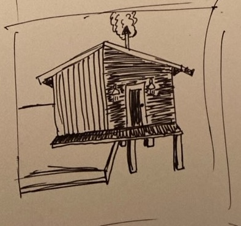

---

# For Sale: Cabin In The Woods

- cozy off-grid cabin

---

# For Sale: Cabin In The Woods

- cozy off-grid cabin
- beautiful mountain view from the deck

---

# For Sale: Cabin In The Woods

- cozy off-grid cabin
- beautiful mountain view from the deck
- classic cedar siding

---

# For Sale: Cabin In The Woods

- cozy off-grid cabin
- beautiful mountain view from the deck
- classic cedar siding
- wood stove

---

# Project: Cabin In The Woods

---

# Project: Cabin In The Woods

- large concrete pad

---

# Project: Cabin In The Woods

- large concrete pad
- located to get the best view

---

# Project: Cabin In The Woods

- large concrete pad
- located to get the best view
- cedar siding, metal roof

---

# Project: Cabin In The Woods

- large concrete pad
- located to get the best view
- cedar siding, metal roof
- wood stove

---

## What went wrong?

What parts of this picture look off?

---

## What went wrong?

---

## What went wrong?

- concrete pad too big

---

## What went wrong?

- concrete pad too big
- concrete pad in wrong place 

---

## What went wrong?

- concrete pad too big
- concrete pad in wrong place 
- no time for windows 

---

## What went wrong?

---

## What went wrong?

- Product owners: "devs took forever to start"

---

## What went wrong?

- Product owners: "devs took forever to start"
- Customers: "...why is it like this??"

---

## What went wrong?

- Product owners: "devs took forever to start"
- Customers: "...why is it like this??"
- Devs worked hard, but nobody's happy

---

## So what happened?

---

# But first, Hi 👋🏻

I'm Alex Bird  
Distinguished Software Engineer  
Hunter Industries  

[mstdn.ca/@alexanderbird](https://mstdn.ca/@alexanderbird)  
[alexanderbird.software](https://alexanderbird.software)  

---

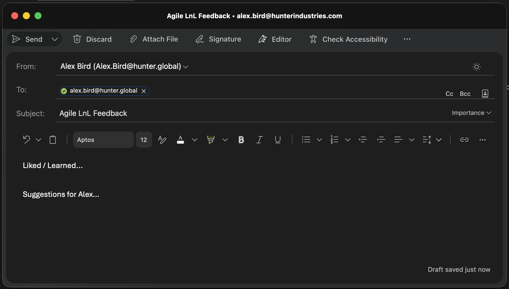

---

## So what happened?

---

# Product Owner's Feature List
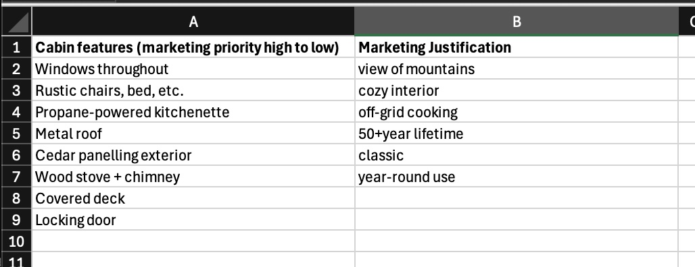

---

# Product Owner's Expected Burn-Up
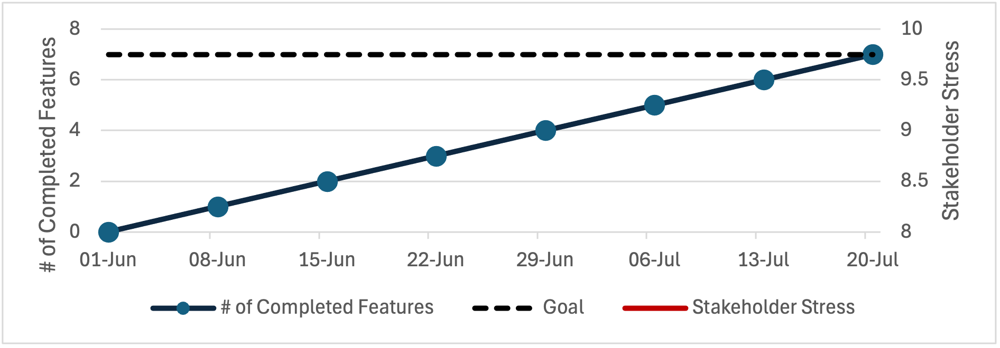

---

# Product Owner's Expected Burn-Up
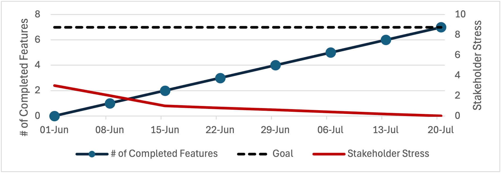

---

# But...

---

# Dev Team's Feature List
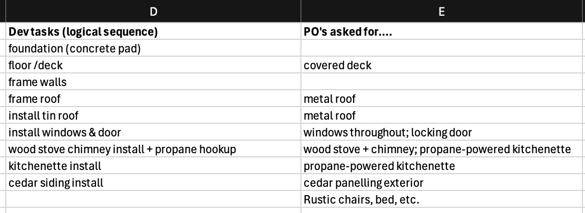

---

# Week 1
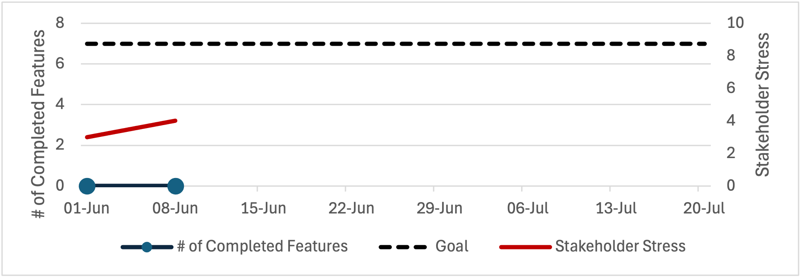

---

# Week 2
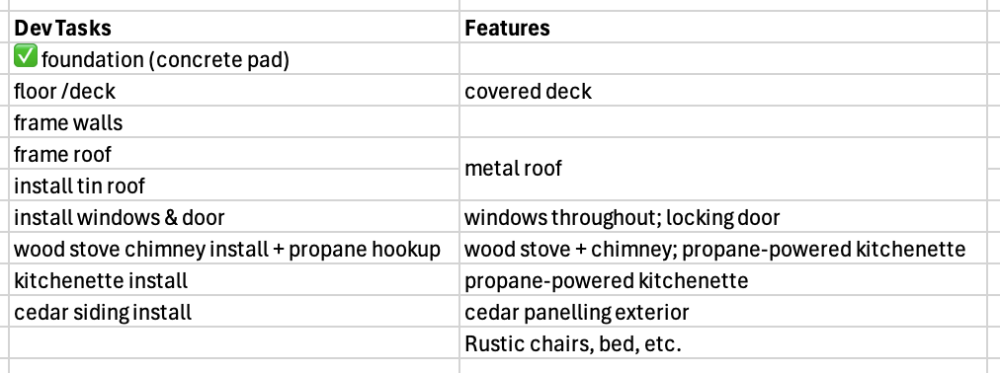

---

# Week 2
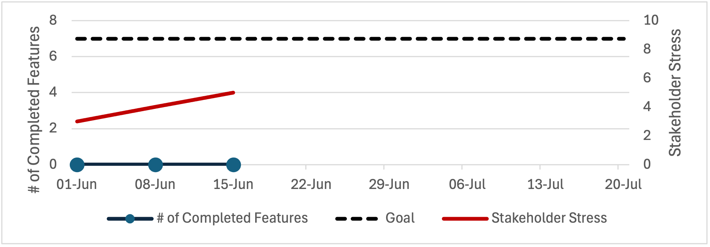

---

# Week 3
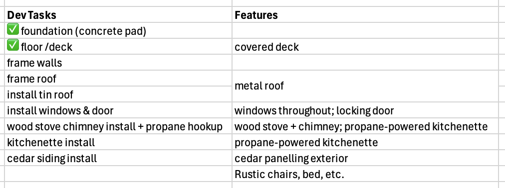

---

# Week 3
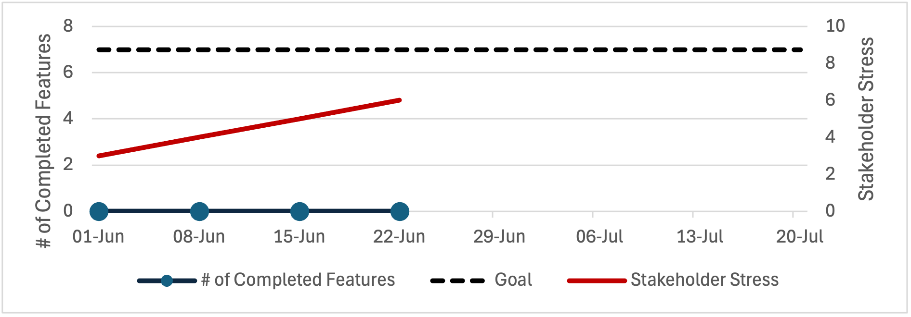

---

# Weeks 4-5
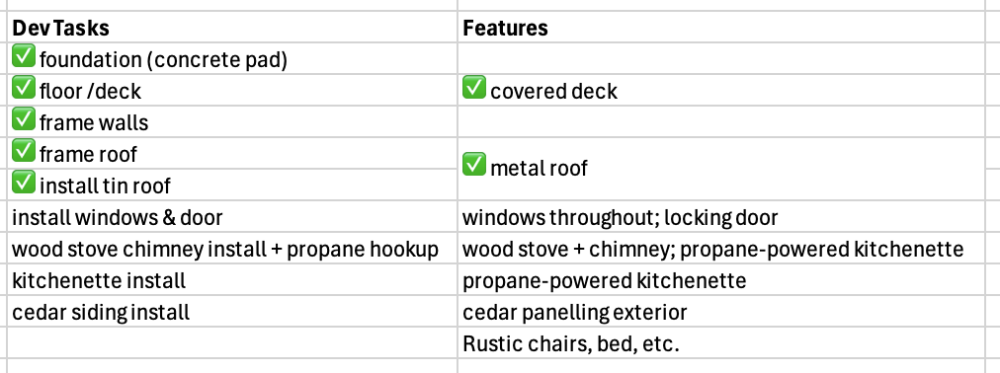

---

# Weeks 4-5
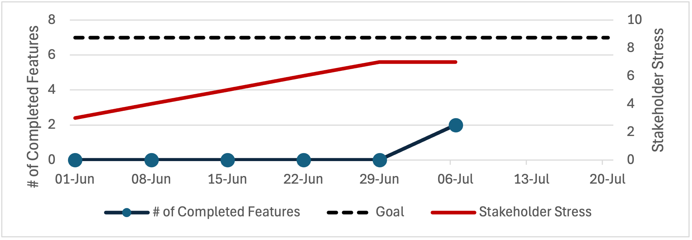

---

# Last Minute Calendar Invite
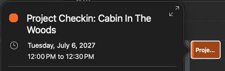

---

# Last Minute Calendar Invite

---

# Week 6

---

# Week 6
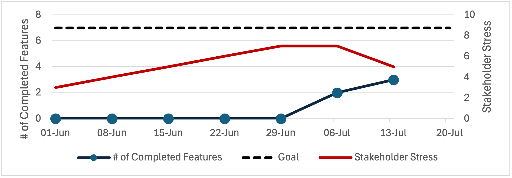

---

# Week 7
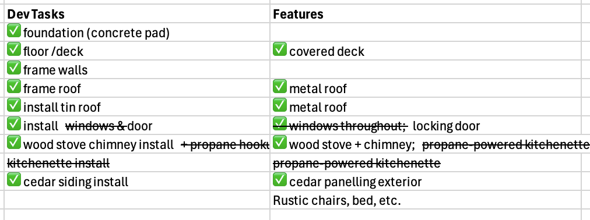

---

# Week 7
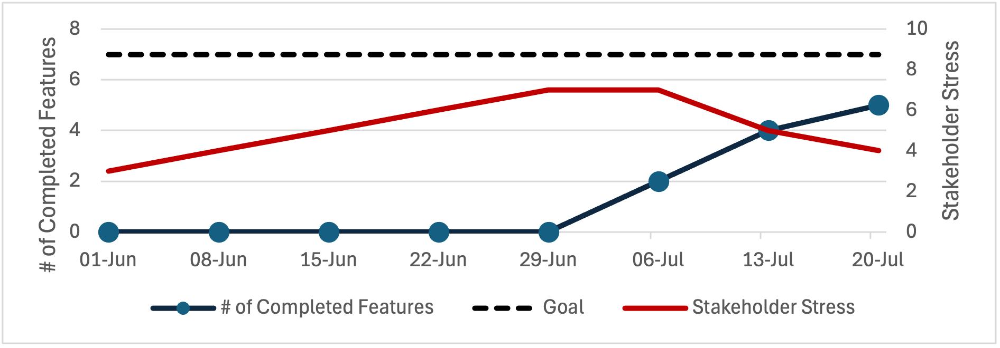

---

# On Time
# On Budget
# 😉

---

# Dev Team's Feature List
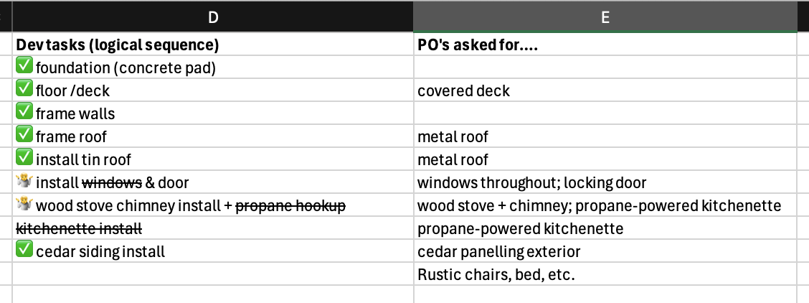

---

# Product Owner's Feature List
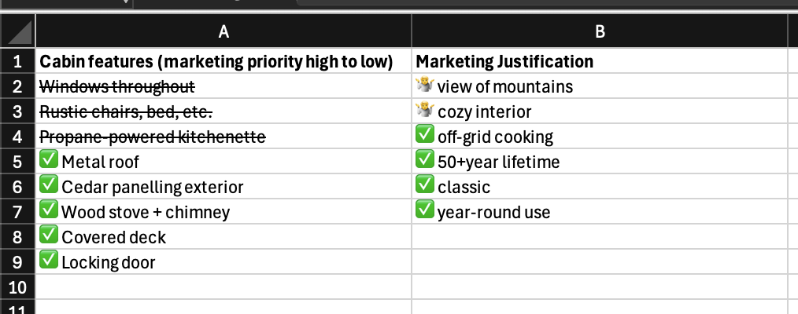

---

# Find Architecture-Product Fit

---

# Find Architecture-Product Fit

- De-stress Stakeholders

---

# Find Architecture-Product Fit

- De-stress Stakeholders
- Delight Customers

---

# Find Architecture-Product Fit

- De-stress Stakeholders
- Delight Customers
- Reduce Waste

---

# "Bro it's 2026"

---

# "But can't AI just...?"

---

# "But can't AI just...?"

- oops you built the wrong thing

---

# "But can't AI just...?"

- oops you built the wrong thing
  - nobody wants it

---

# "But can't AI just...?"

- oops you built the wrong thing
  - nobody wants it
- oops you overengineered it

---

# "But can't AI just...?"

- oops you built the wrong thing
  - nobody wants it
- oops you overengineered it
  - it's too expensive to run

---

# "But can't AI just...?"

- oops you built the wrong thing
  - nobody wants it
- oops you overengineered it
  - it's too expensive to run
- oops the bot did exactly what was asked

---

# "But can't AI just...?"

- oops you built the wrong thing
  - nobody wants it
- oops you overengineered it
  - it's too expensive to run
- oops the bot did exactly what was asked
  - but everyone hates it

---

# "But can't AI just...?"

The faster you go, the more important your direction

---

# "But can't AI just...?"

The faster you go, the more important your direction

- Walking? Adjust as you go

---

# "But can't AI just...?"

The faster you go, the more important your direction

- Walking? Adjust as you go
- Launching a rocket? Point it carefully

---

# "But can't AI just...?"

What is the next most important thing to build?

---

### "But doesn't rapid prototyping answer...?"

Yes, but it's our job to aim the machine

---

### "But doesn't rapid prototyping answer...?"

Yes, but it's our job to aim the machine

 - Someone has to evaluate the experiments

---

### "But doesn't rapid prototyping answer...?"

Yes, but it's our job to aim the machine

 - Someone has to evaluate the experiments
 - Each experiment has a cost

---

### "But doesn't rapid prototyping answer...?"

Yes, but it's our job to aim the machine

 - Someone has to evaluate the experiments
 - Each experiment has a cost
 - So what shall we prototype next?

---

# Someone has to aim the machine

How do we aim the machine well?

That's what we're talking about today

---

# Today we're talking about how to:

---

# Today we're talking about how to:

- Build the right product

---

# Today we're talking about how to:

- Build the right product
- Build the right infrastructure

---

# Today we're talking about how to:

- Build the right product
- Build the right infrastructure
- Make sure the two match

---

# Find Architecture-Product Fit

- De-stress Stakeholders
- Delight Customers
- Reduce Waste

---

# Find Architecture-Product Fit

- Happy Stakeholders
- Happy Customers
- Happy Devs

---

# Find Architecture-Product Fit

 - Backlog Shapes: 1D, 2D
 - Architecture-informed 2D Backlogs
 - Feature-Architecture Hors D'oeuvres
 - Pitfalls
 - Things to Try This Week

---

# 1D backlog

- List the stuff

---

# If the devs get to rank the list

---

# If the devs get to rank the list

- Long gaps of invisible "backend work" 🏒

---

# If the devs get to rank the list

- Long gaps of invisible "backend work" 🏒
- Technically related items grouped together

---

# If the devs get to rank the list

- Long gaps of invisible "backend work" 🏒
- Technically related items grouped together
    - Lots of features built, but no end-to-end customer experience

---

# If the devs get to rank the list

- Long gaps of invisible "backend work" 🏒
- Technically related items grouped together
    - Lots of features built, but no end-to-end customer experience
- No cohesive product until the end

---

# If the POs get to rank the list

---

# If the POs get to rank the list

- Highest priority feature takes forever 🏒

---

# If the POs get to rank the list

- Highest priority feature takes forever 🏒
    - The devs end up doing lots of invisible "backend work" anyway

---

# If the POs get to rank the list

- Highest priority feature takes forever 🏒
    - The devs end up doing lots of invisible "backend work" anyway
- No cohesive product until the end

---

# Book: User Story Mapping
## Discover the Whole Story, Build the Right Product

*By* Jeff Patton
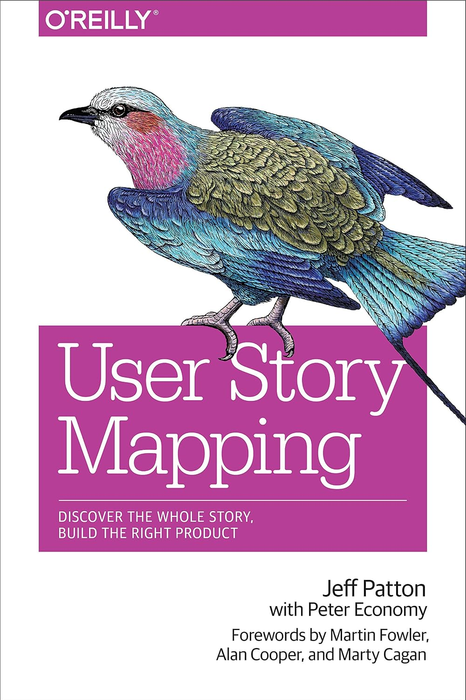

---

# 2D backlog

---

# 2D backlog

- Horizontal Axis: Customer Journey

---

# 2D backlog

- Horizontal Axis: Customer Journey
- Vertical Axis: Priority or sequence

---

# User Story Map
## For a note-taking web app

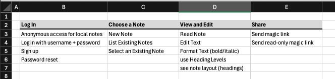

---

# How to Rank

---

# How to Rank
- Product Owners and Devs must collaborate

---

# How to Rank
- Product Owners and Devs must collaborate
- What is possible to build this week?

---

# How to Rank
- Product Owners and Devs must collaborate
- What is possible to build this week?
- What is worth building this week?

---

# How to Rank
- Product Owners and Devs must collaborate
- What is possible to build this week?
- What is worth building this week?
- What do we need to stitch that together into a complete user journey?

---

# User Story Map
## Slice 1

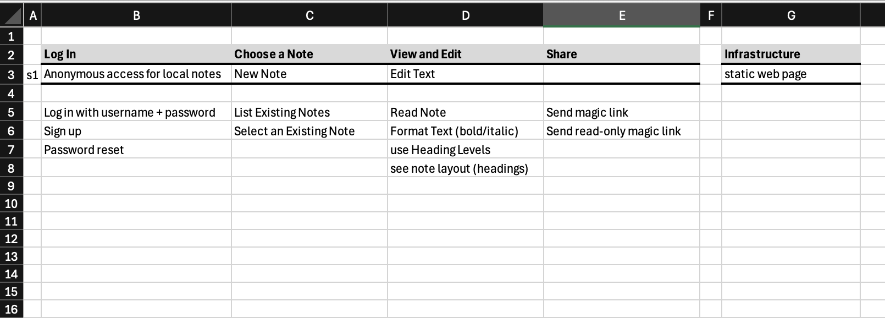

---

# User Story Map
## Slice 2

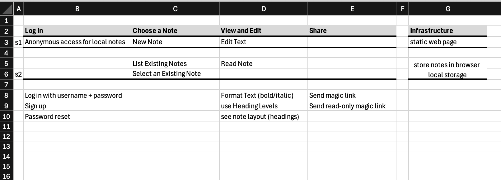

---

# User Story Map
## Slice 2 (Alternative)

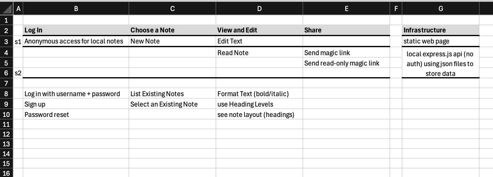

---

# User Story Map
## Slice 3

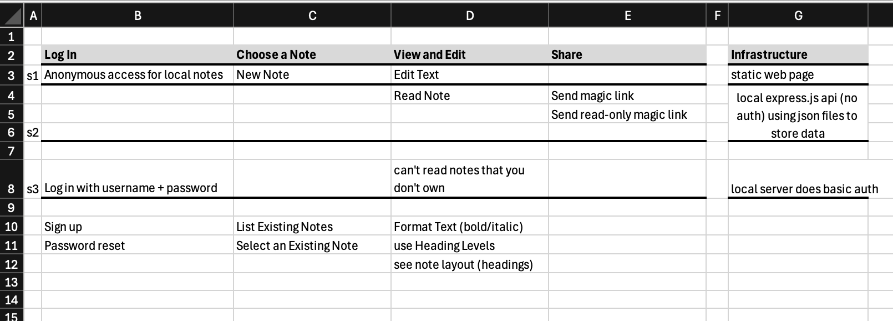

---

# User Story Map
## Slice 4: "backend work"

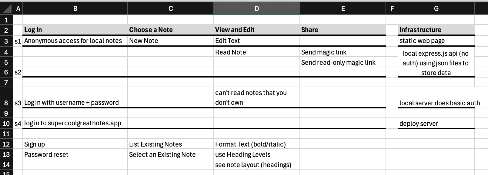

---

# Find Architecture-Product Fit

---

# Find Architecture-Product Fit

- Our 2D backlog puts features in user context

---

# Find Architecture-Product Fit

- Our 2D backlog puts features in user context
- We choose valuable features that give an excuse for infra

---

# Find Architecture-Product Fit

- Our 2D backlog puts features in user context
- We choose valuable features that give an excuse for infra
- We build just enough infra to build valuable features

---

# Find Architecture-Product Fit

- Our 2D backlog puts features in user context
- We choose valuable features that give an excuse for infra
- We build just enough infra to build valuable features
- Delivered features earns trust

---

# Find Architecture-Product Fit

- Our 2D backlog puts features in user context
- We choose valuable features that give an excuse for infra
- We build just enough infra to build valuable features
- Delivered features earns trust
- We spend trust on "backend work" &mdash; on infra work

---

# Find Architecture-Product Fit

- 2D backlog for context
- features as excuse for infra
- just enough infra for features
- features earn trust for infra 

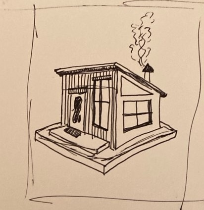

---

# Find Architecture-Product Fit

 - Backlog Shapes: 1D, 2D
 - Architecture-informed 2D Backlogs
 - Feature-Architecture Hors D'oeuvres
 - Pitfalls
 - Things to Try This Week

---

# Features as excuse for infra

- devs say "we need a db"
- play the simplest feature that needs db
- e.g. when we return to the page tomorrow, data is still there

---

# Just enough infra for the feature

- product says "when we return to the page tomorrow, data is still there"
- build the simplest infra to support the feature
- e.g. store data in local storage

---

# Features as excuse for infra

- devs say "we need a db"
- play the simplest feature that needs db
- e.g. "when I browse from another device, data is still there"

---

# Just enough infra for the feature

- product says "when I browse from another device, data is still there"
- build the simplest infra to support the feature
- e.g. basic db, no auth

---

# Features as excuse for infra

- devs say "we need authentication"
- play the simplest feature that needs db
- e.g. "when I browse from user B's account, I can't see user A's data"

---

# And so on

---

# Why

- de-stress stakeholders
- delight customers 
- reduce waste

---

# 1D backlogs make waste

- we have to build a bunch of infra for our first feature
- we have to build a bunch of features for the first user journey

---

# 1D backlogs make stress

- we have nothing to report while we're building infra
- the demos make no sense when the features are disjointed

---

# 1D backlogs make waste

- we build too much infra
- we build too many features

---

# 1D backlogs make customers sad

- why can't I....????
- why is it so.....????

---

#### Architecture-Product Fit

Basically we just need to talk to each other

---

#### Architecture-Product Fit

Basically we just need to talk to each other

- devs to respect PO's business strategy

---

#### Architecture-Product Fit

Basically we just need to talk to each other

- devs to respect PO's business strategy
- PO's to respect devs' technical advice

---

#### Architecture-Product Fit

Basically we just need to talk to each other

- devs to respect PO's business strategy
- PO's to respect devs' technical advice
- make a plan together

---

#### Architecture-Product Fit

Basically we just need to talk to each other

- devs to respect PO's business strategy
- PO's to respect devs' technical advice
- make a plan together
- so we have stuff to show early on

---

# The Essence

---

# The Essence

- Stakeholders and devs talk

---

# The Essence

- Stakeholders and devs talk
   - marketing/product goals vs technical constraints

---

# The Essence

- Stakeholders and devs talk
   - marketing/product goals vs technical constraints
   - combined into a better plan

---

# The Essence

- Stakeholders and devs talk
   - marketing/product goals vs technical constraints
   - combined into a better plan
- Build the features that drive the infrastructure

---

# The Essence

- Stakeholders and devs talk
   - marketing/product goals vs technical constraints
   - combined into a better plan
- Build the features that drive the infrastructure
   - Rejig the priorities for reportable progress

---

# The Essence

- Stakeholders and devs talk
   - marketing/product goals vs technical constraints
   - combined into a better plan
- Build the features that drive the infrastructure
   - Rejig the priorities for reportable progress
       - (instead of the dreaded hockey stick)

---

# The Essence

- Stakeholders and devs talk
   - marketing/product goals vs technical constraints
   - combined into a better plan
- Build the features that drive the infrastructure
   - Rejig the priorities for reportable progress
       - (instead of the dreaded hockey stick)
- Build the infrastructure to support the features

---

# The Essence

- Stakeholders and devs talk
   - marketing/product goals vs technical constraints
   - combined into a better plan
- Build the features that drive the infrastructure
   - Rejig the priorities for reportable progress
       - (instead of the dreaded hockey stick)
- Build the infrastructure to support the features
   - Fake it at first

---

# Wait isn't this just XP?

- Yeah basically
- This stuff still works!

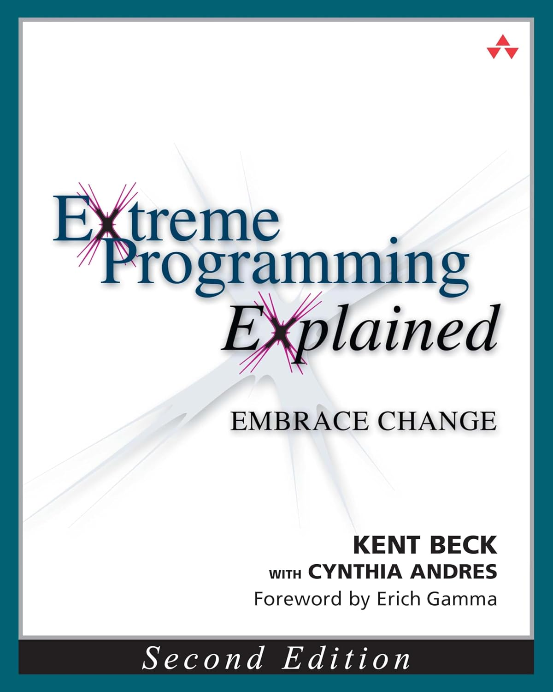

---

# Wait isn't this just XP?

---

# Wait isn't this just XP?

- Values: Communication, Simplicity, Feedback, Respect

---

# Wait isn't this just XP?

- Values: Communication, Simplicity, Feedback, Respect
- Principles: Baby Steps, Improvement

---

# Wait isn't this just XP?

- Values: Communication, Simplicity, Feedback, Respect
- Principles: Baby Steps, Improvement
- Practices: Whole Team, Stories, Weekly Cycle

---

# Wait isn't this just XP?

- Values: Communication, Simplicity, Feedback, Respect
- Principles: Baby Steps, Improvement
- Practices: Whole Team, Stories, Weekly Cycle
- Practices: Incremental Design, Incremental Deployment, Negotiated Scope Contract

---

# Wait isn't this just XP?

- Yeah basically
- This stuff still works!

---

# Find Architecture-Product Fit

 - Backlog Shapes: 1D, 2D
 - Architecture-informed 2D Backlogs
 - Feature-Architecture Hors D'oeuvres
 - Pitfalls
 - Things to Try This Week

---

# Build features before infra

Here are some patterns for getting a slice of a feature out before having all the infra built

---

Fake the API &mdash; build frontend-only

---

Real API, canned data

---

Real API, real db, hardcoded user info

---

User info from SSO integration, real API, real db, small scale

---

Big scale data from API to db and back

---

# Find Architecture-Product Fit

 - Backlog Shapes: 1D, 2D
 - Architecture-informed 2D Backlogs
 - Feature-Architecture Hors D'oeuvres
 - Pitfalls
 - Things to Try This Week

---

If you can't change the code easily, iterative development sucks

---

example about YAGNI &mdash; feature flagging hardcoded b/c it was good enough

---

example about YAGNI &mdash; API algorithm hardcoded b/c it was good enough for now

---

# Find Architecture-Product Fit

 - Backlog Shapes: 1D, 2D
 - Architecture-informed 2D Backlogs
 - Feature-Architecture Hors D'oeuvres
 - Pitfalls
 - Things to Try This Week

---

# What Now?

---

# What Now?

- Devs: take time to understand the code 

---

# What Now?

- Devs: take time to understand the code 
- Devs: take time to keep the code malleable

---

# What Now?

- Devs: take time to understand the code 
- Devs: take time to keep the code malleable
- Budget Owners: say yes to unit testing, refactoring

---

# What Now?

- Devs: take time to understand the code 
- Devs: take time to keep the code malleable
- Budget Owners: say yes to unit testing, refactoring
- Budget Owners: say yes to learning time to get better at ⬆

---

# What Now?

- Devs: take time to understand the code 
- Devs: take time to keep the code malleable
- Budget Owners: say yes to unit testing, refactoring
- Budget Owners: say yes to learning time to get better at ⬆
- Everyone: talk to each other often

---

# What Now?

- Devs: take time to understand the code 
- Devs: take time to keep the code malleable
- Budget Owners: say yes to unit testing, refactoring
- Budget Owners: say yes to learning time to get better at ⬆
- Everyone: talk to each other often
    - Like, just hang out and stuff, you know?

---

# Or Else?

If you don't want to invest in malleable code, embrace

---

# Or Else?

If you don't want to invest in malleable code, embrace

- big design up front

---

# Or Else?

If you don't want to invest in malleable code, embrace

- big design up front
- hockey stick status reports

---

# Or Else?

If you don't want to invest in malleable code, embrace

- big design up front
- hockey stick status reports
- stressed stakeholders

---

# Or Else?

If you don't want to invest in malleable code, embrace

- big design up front
- hockey stick status reports
- stressed stakeholders
- confused customers

---

# Business Tradeoff

---

# Business Tradeoff

- Invest in architecture-product fit through iterative development

---

# Business Tradeoff

- Invest in architecture-product fit through iterative development
    - dev skills for malleable code, relationships between eng/product

---

# Business Tradeoff

- Invest in architecture-product fit through iterative development
    - dev skills for malleable code, relationships between eng/product
    - benefit: predictable delivery, happier customers & sales

---

# Business Tradeoff

- Invest in architecture-product fit through iterative development
    - dev skills for malleable code, relationships between eng/product
    - benefit: predictable delivery, happier customers & sales
    - downside: $$$

---

# Business Tradeoff

- Invest in architecture-product fit through iterative development
    - dev skills for malleable code, relationships between eng/product
    - benefit: predictable delivery, happier customers & sales
    - downside: $$$
- Aim for architecture-product fit through big design up front

---

# Business Tradeoff

- Invest in architecture-product fit through iterative development
    - dev skills for malleable code, relationships between eng/product
    - benefit: predictable delivery, happier customers & sales
    - downside: $$$
- Aim for architecture-product fit through big design up front
    - benefit: no need to learn dev skills for malleable code, OK to keep silos

---

# Business Tradeoff

- Invest in architecture-product fit through iterative development
    - dev skills for malleable code, relationships between eng/product
    - benefit: predictable delivery, happier customers & sales
    - downside: $$$
- Aim for architecture-product fit through big design up front
    - benefit: no need to learn dev skills for malleable code, OK to keep silos
    - cost: BDUF is expensive and often wrong ($$$)

---

# Business Tradeoff

- Invest in architecture-product fit through iterative development
    - dev skills for malleable code, relationships between eng/product
    - benefit: predictable delivery, happier customers & sales
    - downside: $$$
- Aim for architecture-product fit through big design up front
    - benefit: no need to learn dev skills for malleable code, OK to keep silos
    - cost: BDUF is expensive and often wrong ($$$)
    - cost: hockey stick status reports, stress, waste ($$$)

---

# Business Tradeoff

---

# Business Tradeoff

- Invest in architecture-product fit through iterative development

---

# Business Tradeoff

- Invest in architecture-product fit through iterative development
    - people learn, talk to each other

---

# Business Tradeoff

- Invest in architecture-product fit through iterative development
    - people learn, talk to each other
    - $$$

---

# Business Tradeoff

- Invest in architecture-product fit through iterative development
    - people learn, talk to each other
    - $$$
- Aim for architecture-product fit through big design up front

---

# Business Tradeoff

- Invest in architecture-product fit through iterative development
    - people learn, talk to each other
    - $$$
- Aim for architecture-product fit through big design up front
    - stress and waste

---

# Business Tradeoff

- Invest in architecture-product fit through iterative development
    - people learn, talk to each other
    - $$$
- Aim for architecture-product fit through big design up front
    - stress and waste
    - $$$

---

# Business Tradeoff

---

# Business Tradeoff

- Invest in architecture-product fit through iterative development

---

# Business Tradeoff

- Invest in architecture-product fit through iterative development
    - remember to account for the learning cost

---

# Business Tradeoff

- Invest in architecture-product fit through iterative development
    - remember to account for the learning cost
- Aim for architecture-product fit through big design up front

---

# Business Tradeoff

- Invest in architecture-product fit through iterative development
    - remember to account for the learning cost
- Aim for architecture-product fit through big design up front
    - it's been half a century, is BDUF working for anyone?

---

# Business Tradeoff

---

# Business Tradeoff

- Invest in architecture-product fit through iterative development

---

# Business Tradeoff

- Invest in architecture-product fit through iterative development
    - remember to account for the business value of flexibility

---

# Business Tradeoff

- Invest in architecture-product fit through iterative development
    - remember to account for the business value of flexibility
- Aim for architecture-product fit through big design up front

---

# Business Tradeoff

- Invest in architecture-product fit through iterative development
    - remember to account for the business value of flexibility
- Aim for architecture-product fit through big design up front
    - if you don't want to rock the boat, BDUF feels safer

---

---

If you want to explore the iterative approach,  
Here are some retro templates

---

# Communication Retro
## An idea for a one-off team retro

---

# Communication Retro
## An idea for a one-off team retro

- "what devs knew and product didn't"

---

# Communication Retro
## An idea for a one-off team retro

- "what devs knew and product didn't"
- "what product knew and devs didn't"

---

# Communication Retro
## An idea for a one-off team retro

- "what devs knew and product didn't"
- "what product knew and devs didn't"
- "stuff we built that we didn't need"

---

# Communication Retro
## An idea for a one-off team retro

- "what devs knew and product didn't"
- "what product knew and devs didn't"
- "stuff we built that we didn't need"
- "stuff we needed that we didn't build"

---

# Communication Retro
## An idea for a one-off team retro

Possible action items

---

# Communication Retro
## An idea for a one-off team retro

Possible action items

- specific conversations to be had

---

# Communication Retro
## An idea for a one-off team retro

Possible action items

- specific conversations to be had
    - "Sally and Bob should chat about X"

---

# Communication Retro
## An idea for a one-off team retro

Possible action items

- specific conversations to be had
    - "Sally and Bob should chat about X"
- process experiments

---

# Communication Retro
## An idea for a one-off team retro

Possible action items

- specific conversations to be had
    - "Sally and Bob should chat about X"
- process experiments
    - "Next project kickoff, let's try a 2D backlog. Andy's going to facilitate."

---

# Communication Retro
## An idea for a one-off team retro

Possible action items

- specific conversations to be had
    - "Sally and Bob should chat about X"
- process experiments
    - "Next project kickoff, let's try a 2D backlog. Andy's going to facilitate."
- what else??

---

# Communication Retro
## An idea for a one-off team retro

Possible action items

- specific conversations to be had
    - "Sally and Bob should chat about X"
- process experiments
    - "Next project kickoff, let's try a 2D backlog. Andy's going to facilitate."
- what else??
    - (have a retro to find out 🙂)

---

# Code Malleability Retro
## An idea for a one-off team retro

---

# Code Malleability Retro
## An idea for a one-off team retro

- "malleable: code that was easy to change"

---

# Code Malleability Retro
## An idea for a one-off team retro

- "malleable: code that was easy to change"
- "ossified: code that was hard to change"

---

# Code Malleability Retro
## An idea for a one-off team retro

- "malleable: code that was easy to change"
- "ossified: code that was hard to change"
- "refactored: we learned X, then we changed Y"

---

# Code Malleability Retro
## An idea for a one-off team retro

- "malleable: code that was easy to change"
- "ossified: code that was hard to change"
- "refactored: we learned X, then we changed Y"
- "disappointed: code we used, wanted to change, but didn't"

---

# Code Malleability Retro
## An idea for a one-off team retro

Possible action items

---

# Code Malleability Retro
## An idea for a one-off team retro

Possible action items

- cleanup:

---

# Code Malleability Retro
## An idea for a one-off team retro

Possible action items

- cleanup:
    - "we're often working on module X, which is ossified"

---

# Code Malleability Retro
## An idea for a one-off team retro

Possible action items

- cleanup:
    - "we're often working on module X, which is ossified"
    - "Sue and Frank are going to take next week to clean it up, let them know if you have ideas"

---

# Code Malleability Retro
## An idea for a one-off team retro

Possible action items

---

# Code Malleability Retro
## An idea for a one-off team retro

Possible action items

- learning

---

# Code Malleability Retro
## An idea for a one-off team retro

Possible action items

- learning
    - "We're going to take an hour each morning this month to practice TDD and refactoring"

---

# Code Malleability Retro
## An idea for a one-off team retro

Possible action items

- learning
    - "We're going to take an hour each morning this month to practice TDD and refactoring"
- understanding

---

# Code Malleability Retro
## An idea for a one-off team retro

Possible action items

- learning
    - "We're going to take an hour each morning this month to practice TDD and refactoring"
- understanding
    - "This month, we're going to allocate time to review all the generated code before pushing it"

---

Quick aside to whoever's facilitating the retro:

If there's no budget to take the actions, don't run the retros &mdash; they'll just be frustrating

---

Aside from the aside:

If there's no budget to take the actions, embrace the stress and hockey stick status updates of BDUF

---

# Final Thoughts

---

# Final Thoughts

- Rank your tasks with dev and product together

---

# Final Thoughts

- Rank your tasks with dev and product together
- Build features that give an excuse to do infra work

---

# Final Thoughts

- Rank your tasks with dev and product together
- Build features that give an excuse to do infra work
- Do just enough infra work to build the features

---

# Final Thoughts

- Rank your tasks with dev and product together
- Build features that give an excuse to do infra work
- Do just enough infra work to build the features
- Invest in malleable code

---

# Final Thoughts

- Rank your tasks with dev and product together
- Build features that give an excuse to do infra work
- Do just enough infra work to build the features
- Invest in malleable code
- Happy stakeholders, happy customers, happy devs!

---

# Thanks for Having Me!

Alex Bird  
Distinguished Software Engineer  
Hunter Industries  

[mstdn.ca/@alexanderbird](https://mstdn.ca/@alexanderbird)  
[alexanderbird.software](https://alexanderbird.software)  

